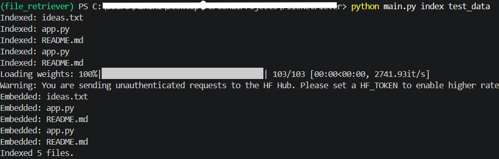
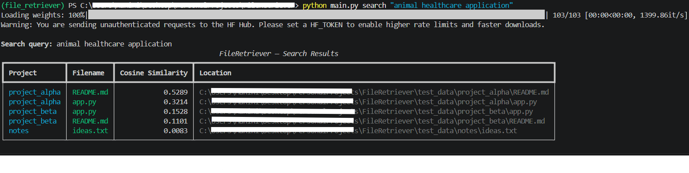

# RAG FileRetriever

A Python-based semantic file retrieval tool that helps users find files using natural-language queries rather than exact filenames or keywords.

The application scans local directories, extracts supported text content, generates embeddings, and uses FAISS to retrieve similar files. Search results are grouped by project and displayed in the terminal.

**Current status:** Phase 2 completed — functional CLI prototype.

## Features

- Recursive directory scanning
- File metadata storage using SQLite
- Text extraction from `.txt`, `.md`, `.py`, `.json`, and `.csv`
- Semantic embeddings using Sentence Transformers
- Vector similarity search using FAISS
- Cosine similarity scoring through normalized vectors
- Project-based grouping of search results
- Rich-formatted CLI output
- Input validation and basic index consistency checks
- Repeated indexing with SQLite upserts
- Lazy model initialization and in-process caching

## Tech Stack

| Technology | Purpose |
|---|---|
| Python | Core application |
| Sentence Transformers | Text embeddings |
| all-MiniLM-L6-v2 | Embedding model |
| FAISS | Vector similarity search |
| SQLite | File metadata and extracted content |
| NumPy | Vector processing and ID mapping |
| Rich | Terminal output |
| argparse | Command-line interface |

## Project Structure

```text
FileRetriever/
├── main.py
├── retrieve_file/
│   ├── __init__.py
│   ├── database.py
│   ├── scanner.py
│   ├── embeddings.py
│   ├── vector_store.py
│   └── semantic_search.py
├── test_data/
├── data/                  # Generated locally
├── requirements.txt
├── .gitignore
└── README.md
```

## Installation

Requires Python and pip.

Clone the repository:

```bash
git clone <repository-url>
cd FileRetriever
```

Create a virtual environment:

```bash
python -m venv .venv
```

Activate it on Windows:

```powershell
.\.venv\Scripts\Activate.ps1
```

Install dependencies:

```bash
pip install -r requirements.txt
```

The embedding model may be downloaded automatically on first use.

## Usage

### Index a directory

```bash
python main.py index test_data
```

This scans the directory, stores file information in SQLite, generates embeddings for searchable content, and builds the FAISS index.

### Search files

```bash
python main.py search "animal healthcare application"
```

The application returns similar files grouped by their parent directory, including file paths and cosine similarity scores.

### CLI help

```bash
python main.py --help
```

## Screenshots

### File Indexing

Recursively scans directories, extracts supported text content, and builds the FAISS vector index.



### Semantic Search

Retrieves files using natural-language queries and displays project-grouped results with cosine similarity scores.



## How It Works

1. **Scan:** Discover files recursively in a selected directory.
2. **Extract:** Read supported text-based files.
3. **Store:** Save file metadata and extracted content in SQLite.
4. **Embed:** Convert file content into numerical vectors using Sentence Transformers.
5. **Index:** Normalize and store vectors in FAISS, with a separate file-ID mapping.
6. **Retrieve:** Convert the search query into an embedding and retrieve the nearest vectors.
7. **Group:** Organize matching files by parent directory.
8. **Display:** Present results using Rich.

## Current Limitations

- FileRetriever generates one embedding per file using all-MiniLM-L6-v2, which processes a maximum of 256 tokens per input. Content beyond this limit is truncated and may not influence retrieval. Document chunking is planned for Phase 3.
- Indexing rebuilds embeddings for all searchable database records.
- The embedding model is reloaded for each separate CLI invocation.
- Retrieval currently uses semantic similarity only.
- Project grouping uses the immediate parent directory.
- Search returns nearest matches even when similarity is low.
- Previously indexed files are not automatically removed when deleted from disk.
- Advanced document formats and multimedia content are not yet supported.

## Development Roadmap

- [x] Phase 1 — Foundation Prototype
- [x] Phase 2 — Code Quality & CLI
- [ ] Phase 3 — Project-Level & Hybrid Retrieval
- [ ] Phase 4 — Incremental Indexing
- [ ] Phase 5 — Real-World Formats & Privacy
- [ ] Phase 6 — Optional Ollama/OpenAI Integration
- [ ] Phase 7 — Evaluation & Testing
- [ ] Phase 8 — Portfolio Release

## Project Status

This project is under active development. The current release is a working semantic retrieval prototype, not a production-ready search system.

The next milestone focuses on improving project-level ranking, hybrid retrieval, and relevance filtering.
