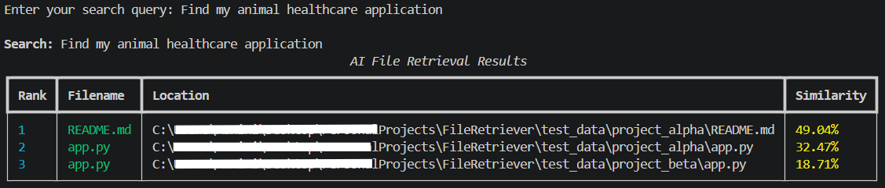

# Local AI File Retriever

An offline, AI-powered file retrieval system that finds files using natural-language queries, even when filenames are unknown.

## Features
- Recursive file scanning
- SQLite metadata and content indexing
- Keyword search
- Semantic search using Sentence Transformers
- FAISS vector similarity search
- Ranked search results with similarity scores
- Local processing without paid APIs

## Tech Stack
Python, SQLite, Sentence Transformers, FAISS, NumPy, Rich

## Setup

```bash
pip install -r requirements.txt
```

## Usage

Build the file index:

```bash
python scanner.py
python vector_store.py
```

Search using natural language:

```bash
python semantic_search.py
```
## Demo — Semantic File Retrieval

Find relevant files using natural-language descriptions,
even when the query doesn't match their filenames.



## Current Scope

The application currently searches indexed files within a configured test directory. Project-level grouping, hybrid retrieval, and broader filesystem indexing are planned improvements.